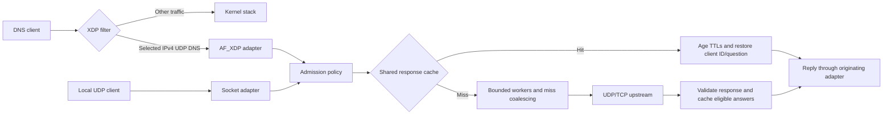

<p align="center">
  
</p>

<h1 align="center">XDP DNS Accelerator</h1>

<p align="center">
  A Linux DNS packet accelerator built with eBPF, AF_XDP, and C++20.<br>
  Shared response caching, bounded concurrency, and privilege separation.
</p>

<p align="center">
  
  
  
  
</p>

<p align="center">
  <a href="https://github.com/FireBall82/xdp-dns-accel/actions/workflows/security.yml"></a>
  <a href="https://github.com/FireBall82/xdp-dns-accel/actions/workflows/local-dns.yml"></a>
</p>

A systems programming project exploring DNS caching at the Linux packet boundary.
An eBPF filter redirects selected IPv4 UDP DNS queries to an AF_XDP userspace
service. Cache hits return complete responses with aged TTLs; misses use bounded
workers to contact an upstream resolver, with UDP-to-TCP fallback.

The same C++ resolver core also runs over a localhost UDP socket, with a Python
terminal monitor, systemd services, and NixOS packaging. Unbound supplies the
separate downstream TCP fallback for local deployments.

**Status:** generic XDP/copy and native XDP/copy have isolated functional test
coverage. Hardware zero-copy is implemented but awaits compatible-NIC validation.
Comparative hardware throughput and latency measurements remain pending.
This is a forwarding cache; upstream recursion and DNSSEC validation remain with
the configured resolver.

## Engineering highlights

| Area | Implementation |
| :--- | :--- |
| Packet I/O | eBPF queue selection and CIDR filtering; AF_XDP RX/TX rings with explicit frame ownership and backpressure. |
| DNS correctness | Complete response preservation, compression-aware parsing, request-specific cache keys, TTL aging, and UDP/TCP upstream validation. |
| Shared cache | 4,096 entries in POSIX shared memory; keyed SipHash placement, full-key comparison, robust process-shared locks, and owner-death recovery. |
| Concurrency | Bounded job/reply queues, configurable worker pool, and coalescing of equivalent in-flight cache misses. |
| Security | Privileged supervisor, unprivileged DNS worker, frozen BPF policy maps, bounded client state, and admission rate limits. |
| Observability | Prometheus counters/histograms, terminal monitoring, and a concurrent client benchmark reporting success rate and median/p95/p99 RTT. |
| Verification | Regression tests, ASan/UBSan, two libFuzzer targets, real-packet namespace tests, and isolated NixOS deployment tests. |

## Quick start

On Linux, build and test the resolver without BPF dependencies or root access.
You need a C++20 compiler, CMake 3.20+, and Python 3.11+.

```sh
git clone https://github.com/FireBall82/xdp-dns-accel.git
cd xdp-dns-accel
cmake -S . -B build-local -DENABLE_XDP=OFF
cmake --build build-local -j2
ctest --test-dir build-local --output-on-failure
```

The suite uses local mock upstreams; it does not contact public DNS, attach XDP,
or change your system DNS. When Unbound is available, socket tests also exercise
the local TCP fallback.

For the full XDP build with a reproducible development environment:

```sh
nix develop --command cmake -S . -B build
nix develop --command cmake --build build -j2
nix develop --command ctest --test-dir build --output-on-failure
```

Follow the [isolated veth walkthrough](docs/xdp-guide.md#try-it-with-dig) to send
real DNS queries through AF_XDP, observe cache hits, and clean up the test network.
For localhost services and `dnsctl watch`, use the [local DNS guide](docs/local-dns.md).

## Architecture



The supervisor owns privileged setup and XDP cleanup. The DNS worker drops
privileges before parsing requests or contacting upstreams. Both packet adapters
share the resolver, admission policy, and cache implementation.

The cache stores complete positive responses, including CNAME chains and additional
records. NXDOMAIN/NODATA and stateful EDNS requests are forwarded without caching.
Robust locks protect response snapshots across processes; if an owner dies while
holding a lock, the affected set is invalidated before reuse. Bounded queues and
follower limits keep admitted work finite under load.

## Scope and evidence

The XDP default is generic (SKB) mode with AF_XDP copy mode and one receive queue.
TCP clients, IPv6 transport, VLANs, fragments, and oversized frames use the kernel
path and require a conventional resolver. AAAA records work over IPv4 transport.
Native XDP and zero-copy are explicit modes and fail startup when unsupported.

The [security review](docs/security-review.md) records a reproduced compressed-question
buffer overflow, its fix, and sanitizer/fuzz validation. It also documents access
policy, plaintext upstream transport, and deployment boundaries. The
[validation guide](docs/xdp-guide.md#tests) explains how to rerun each test layer.
CI badges above link to actual workflow results.

The [benchmark procedure](docs/xdp-guide.md#native-xdp-and-zero-copy) emits JSON
with client-observed throughput, errors, and latency percentiles. No speedup or
hardware capacity is claimed without comparative measurements.

## Repository map

| Path | Contents |
| :--- | :--- |
| [`bpf/`](bpf/) | XDP filter and policy maps. |
| [`include/`](include/), [`src/`](src/) | C++ resolver, shared cache, packet adapters, security, and metrics. |
| [`admin/`](admin/) | Python service management and terminal monitor. |
| [`tests/`](tests/) | Regression, fuzz, packet, deployment, and benchmark tools. |
| [`deploy/`](deploy/), [`nix/`](nix/) | systemd integration, packages, NixOS module, and VM tests. |
| [Operations guide](docs/xdp-guide.md) | Build options, DNS semantics, configuration, security, and troubleshooting. |

## Next steps

- Validate hardware zero-copy and compare generic/copy, native/copy, and native/zero-copy on the same NIC.
- Add multiple receive queues and test RSS coverage.
- Extend packet acceleration to IPv6 transport and VLAN-tagged frames.

See [remaining work](TODO.txt). Behavior changes should include a reproducer and
appropriate regression coverage.
