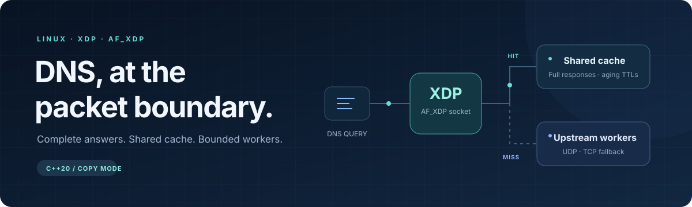
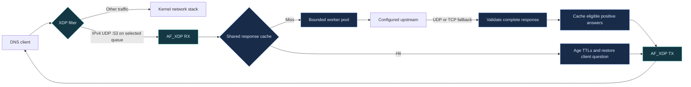

<p align="center">
  
</p>

<h1 align="center">XDP DNS Accelerator</h1>

<p align="center">
  A Linux DNS packet accelerator built with eBPF, AF_XDP, and C++20.<br>
  Complete DNS answers, a shared response cache, and bounded upstream workers.
</p>

<p align="center">
  
  
  
  
</p>

<p align="center">
  <a href="#build">Build</a> ·
  <a href="#try-it-with-dig">Try with dig</a> ·
  <a href="#how-it-works">Architecture</a> ·
  <a href="#tests">Tests</a> ·
  <a href="#troubleshooting">Troubleshooting</a>
</p>

---

The BPF program intercepts IPv4 UDP queries on a selected receive queue and
redirects them to userspace. Cache hits return a complete stored DNS response
with updated TTLs. Misses go to a configurable upstream resolver, with TCP
fallback when the upstream truncates a UDP reply.

| What you get | How it behaves |
| :--- | :--- |
| **Complete answers** | Preserve CNAME chains, multiple addresses, authority records, and additional records. |
| **Correct cache keys** | Compare full questions and request settings, including type, class, flags, upstream, and EDNS. |
| **Aging TTLs** | Decrease every ordinary record's TTL; never cache zero-TTL responses. |
| **Shared storage** | A versioned POSIX shared-memory cache with robust process-shared locks. |
| **Bounded work** | A configurable worker pool and bounded queues keep memory use under control. |
| **Checked packet paths** | Validate packet lengths, checksums, upstream identity, and response questions. |

> **Current scope:** generic (SKB) XDP with **AF_XDP copy mode**, one receive
> queue per daemon. This accelerates IPv4 UDP DNS; it is not a standalone
> recursive resolver. Hardware zero-copy and throughput numbers are not claimed.

## Build

### With Nix

```sh
git clone https://github.com/FireBall82/xdp-dns-accel.git
cd xdp-dns-accel
nix develop

cmake -S . -B build
cmake --build build -j
ctest --test-dir build --output-on-failure
```

Already have the repository? Start at `nix develop` from its directory.

### With your own toolchain

You need Linux, a C++20 compiler, CMake 3.20+, pkg-config, clang with the BPF
backend, llvm-strip, libbpf, libxdp, and pthreads. Python 3 and iproute2 are
required for the namespace smoke test; `dig` is needed for the walkthrough below.

Use the same CMake commands as above. If necessary, select the BPF tools:

```sh
cmake -S . -B build \
  -DBPF_CLANG=/path/to/clang \
  -DBPF_STRIP=/path/to/llvm-strip
```

Explicit CMake settings take precedence over the `CLANG` and `LLVM_STRIP`
environment variables supplied by the Nix shell. The checked-in
[`include/vmlinux.h`](include/vmlinux.h) provides BPF types; the shell generates
it from host BTF if it is missing.

## Try it with dig

This walkthrough creates a **dedicated veth pair and client namespace**. The
daemon runs on the host and uses its existing internet connection for upstream
DNS, so the test requires no NAT or IP-forwarding changes.

Run setup only once, using unused interface and namespace names. Start from the
repository directory. The setup commands work in both Bash and fish.

### 1. Create the test network

```sh
sudo ip netns add dns-client
sudo ip link add veth-dns numtxqueues 1 numrxqueues 1 type veth \
  peer name veth-client numtxqueues 1 numrxqueues 1
sudo ip link set veth-client netns dns-client

sudo ip addr add 192.0.2.1/30 dev veth-dns
sudo ip link set veth-dns up

sudo ip -n dns-client addr add 192.0.2.2/30 dev veth-client
sudo ip -n dns-client link set veth-client up
sudo ip -n dns-client link set lo up
```

### 2. Complete checksums on the sending peer

**Do this before sending queries.** Virtual interfaces can deliver packets to
generic AF_XDP with unfinished UDP checksums. AF_XDP does not expose the kernel's
`CHECKSUM_PARTIAL` indication, so these packets fail strict checksum validation.

```sh
sudo ip netns exec dns-client python3 tests/xdp_smoke.py \
  --disable-tx-checksum veth-client
```

The helper is equivalent to `ethtool -K veth-client tx off` inside that namespace.
It changes only the named interface. Recreating the veth restores its defaults.

### 3. Start the daemon

Keep this terminal open:

```sh
sudo ./build/dns_daemon veth-dns --upstream 1.1.1.1:53 --workers 4
```

Wait for the readiness message:

```text
DNS accelerator ready: XDP attached, AF_XDP queue 0, RX fill ring populated
```

### 4. Query from a second terminal

If `dig` is missing on Nix, open a shell with it:

```sh
nix shell nixpkgs#bind.dnsutils
```

**fish:**

```fish
function dnsdig
    set -l dig_bin (command -v dig)
    sudo ip netns exec dns-client "$dig_bin" \
        @192.0.2.1 $argv +nocookie +ignore +tries=1 +time=3
end
```

<details>
<summary><strong>Bash / Zsh helper</strong></summary>

```bash
dnsdig() {
    local dig_bin
    dig_bin="$(command -v dig)"
    sudo ip netns exec dns-client "$dig_bin" \
        @192.0.2.1 "$@" +nocookie +ignore +tries=1 +time=3
}
```

</details>

Run these in either shell after defining its helper:

```sh
dnsdig example.com A
sleep 2
dnsdig example.com A

dnsdig example.com AAAA
dnsdig example.com TXT
dnsdig does-not-exist.invalid A
```

Look for `status: NOERROR` on positive queries, a decreasing TTL on the repeated
A query, and `NXDOMAIN` for the `.invalid` name. Query time alone does not prove
a cache hit: press **Ctrl+C** in the daemon terminal and check that `hits` is
nonzero.

`+nocookie` matters: requests with EDNS cookies bypass caching. `+ignore` keeps
this UDP-only test from retrying truncated replies over a downstream TCP service
that has not been configured.

### 5. Clean up

Stop the daemon with **Ctrl+C** first, then remove the test network:

```sh
sudo ip link delete veth-dns
sudo ip netns delete dns-client
```

## How it works



### DNS behavior

| Traffic or response | Behavior |
| :--- | :--- |
| A, AAAA, TXT, MX, and other standard query types | Forward complete responses; cache eligible positive answers. |
| NXDOMAIN and NODATA | Preserve the upstream response; do not fabricate addresses or cache negatives. |
| CNAME chains and multiple answers | Preserve the full answer and use the shortest applicable TTL for cache lifetime. |
| EDNS and DNSSEC records | Relay records and flags; no local DNSSEC validation. |
| Cookies, ECS, unsupported EDNS versions, authenticated messages | Forward without caching. |
| Truncated upstream UDP | Try TCP within the same deadline; retain a clean TC response if fallback fails. |
| Oversized downstream response | Return a complete TC response within client, interface, and frame limits. |
| Upstream failure / unsupported opcode | Return SERVFAIL / NOTIMP respectively. |
| IPv6 transport, TCP clients, fragments, VLANs, frames over 2048 bytes | Leave processing to the kernel path. |

**AAAA records are supported over IPv4 UDP.** IPv6 transport itself is not
accelerated. For a complete DNS endpoint, keep a conventional resolver on the
kernel paths, including TCP port 53 for clients retrying a TC reply.

### Cache and backpressure

- **Storage:** 4096 entries in a roughly 19 MiB POSIX shared-memory mapping.
- **Identity:** full-key comparison with label-aware ASCII case normalization;
  cache hits restore the client's capitalization and transaction ID.
- **Lifetime:** monotonic expiration, TTL aging, safe eviction, and no zero-TTL caching.
- **Concurrency:** robust process-shared locks protect complete response snapshots.
- **Isolation:** `/net_accel_dns_v2` is created with mode `0600`; attachment validates
  the ABI and preserves active entries and metrics. The incompatible legacy
  `/net_accel_dns` mapping is unused and is never deleted automatically.
- **Capacity:** bounded work and reply queues; overload generates SERVFAIL when
  response capacity allows. Sustained output saturation may drop replies and
  increments `overloaded`.
- **Frame ownership:** unsent TX frames and unreserved RX fill frames remain
  queued for retry. Shutdown joins workers and releases resources without draining
  queued work.

## Configuration

```text
dns_daemon <interface>
  [--upstream IPv4[:port]]
  [--workers 1..64]
  [--queue 0..63]
  [--bpf-object path]
  [--cache-name /name]
```

| Option | Default | Purpose |
| :--- | :--- | :--- |
| `interface` | Required | Interface whose selected RX queue receives DNS queries. |
| `--upstream` | `1.1.1.1:53` | Upstream resolver and optional port. |
| `--workers` | `4` | Concurrent upstream requests, not additional NIC queues. |
| `--queue` | `0` | AF_XDP receive queue; other queues pass to the kernel. |
| `--bpf-object` | Auto-discovered | Override the adjacent or installed BPF object. |
| `--cache-name` | `/net_accel_dns_v2` | Use a separate private shared cache. |

Use an interface dedicated to this service. The filter intercepts destination
port 53 on that interface **regardless of the destination IP**. Configure RSS or
steering for the selected queue on physical NICs. The daemon does not change
host routes, NAT, offload settings, or resolver configuration.

Loading BPF and configuring AF_XDP require suitable kernel privileges. Root is
the straightforward development setup. The kernel must support generic XDP,
BPF, AF_XDP, and XSK maps. Existing XDP programs are never replaced; graceful
shutdown detaches only the hook owned by this process.

### Optional installation

```sh
sudo cmake --install build --prefix /usr/local
```

The daemon searches beside its executable and in the installation's
`libexec/net_accel_dns` directory for `xdp_filter.bpf.o`. Use `--bpf-object` for a
custom location.

## Tests

### Regression suite

```sh
ctest --test-dir build --output-on-failure
```

The default suite covers DNS parsing, complete responses, TTLs, cache collisions,
concurrent access, process sharing, checksum failures, IPv4 options, bounded
queues, and ring backpressure. Loopback mock DNS servers cover response
validation, TCP fallback, cache hits, TXT, NXDOMAIN, NODATA, and failures.
No public resolver is contacted and no XDP hook is attached by these tests.

### Address and undefined-behavior sanitizers

```sh
cmake -S . -B build-sanitize -DCMAKE_BUILD_TYPE=Debug -DENABLE_SANITIZERS=ON
cmake --build build-sanitize -j
ctest --test-dir build-sanitize --output-on-failure
```

### Privileged XDP smoke test

```sh
sudo python3 tests/xdp_smoke.py ./build/dns_daemon
```

Creates two temporary namespaces and a veth pair, disables checksum offload on
its own test interfaces, and uses a local mock upstream. It checks actual DNS
packets, cache hits, and graceful shutdown, then removes its own interfaces,
namespaces, and uniquely named cache. Root and kernel BPF/AF_XDP support are
required. This test is separate from CTest.

## Troubleshooting

| Symptom | Check or fix |
| :--- | :--- |
| `Queries=0`, `malformed` rises, `bad_udp_checksums` rises | Disable TX checksum offload **on the sending veth peer** using step 2 above. |
| `bad_ip_checksums` rises | Check the packet source or capture; invalid IPv4 headers are rejected. |
| `Queries` and `forwarded` rise, `failures` rises | Check upstream reachability with `dig @1.1.1.1 example.com A +nocookie` from the daemon's namespace. |
| No RX activity | Check both veth ends are up, addresses are correct, and traffic lands on the selected RX queue. |
| Queries work but cache hits stay at zero | Use `+nocookie`; negatives, zero-TTL replies, and stateful EDNS options bypass caching. |
| A reply has `tc` set | The answer exceeds a UDP limit; a conventional downstream TCP resolver is required for client retry. |
| BPF attach fails because a program already exists | Stop the previous owner cleanly; the daemon refuses to replace an existing hook. |
| BPF or UMEM allocation fails | Check kernel support, permissions, and the service's locked-memory limit on older kernels. |
| `dns_network_regressions` fails with socket permission errors | Run the tests where local sockets and temporary POSIX shared memory are allowed. |

The daemon prints its readiness message after attaching XDP and populating the
RX fill ring. The first rejected UDP checksum emits a diagnostic immediately.
On **Ctrl+C**, final counters report queries, cache hits, upstream requests,
failures, overload, malformed input, and separate IP/UDP checksum failures.

## Project layout

```text
bpf/                 XDP packet filter and maps
include/             Protocol, shared-cache, queue, and ring interfaces
src/                 Packet handling, upstream resolution, and daemon
tests/               Regression suite and privileged namespace smoke test
docs/assets/         README artwork
flake.nix            Linux development environment
CMakeLists.txt       Build, test, sanitizer, and install targets
```

## Roadmap

- Native XDP and hardware zero-copy as explicit, benchmarked modes.
- Multiple receive queues with dedicated event loops and RSS coverage.
- Optional acceleration for IPv6 transport and VLAN-tagged frames.
- Deployment-specific systemd and namespace setup.
- Measured throughput/latency and exported runtime metrics under sustained load.

See [`TODO.txt`](TODO.txt) for remaining work. Contributions should include a
reproducer and regression coverage for behavior changes.
