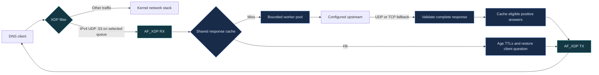

# Build, run, and validate

[Project overview](../README.md) · [Local DNS and services](local-dns.md)

Run the commands below from the repository root. The XDP walkthrough uses
temporary network namespaces; building and running CTest needs no root.

## Build

### Local DNS and terminal monitor

Use `dnsctl watch` for live query rates, cache hits, processing time, failures,
and queue depths. `dnsctl check` sends UDP/TCP test lookups; `dnsctl status --json`
provides a snapshot for scripts. Monitoring needs no sudo or access code.

```sh
nix develop --command cmake -S . -B build
nix develop --command cmake --build build -j2
./build/dnsctl watch
```

The default Nix package supplies localhost UDP DNS, Unbound TCP fallback, and the
CLI without BPF dependencies. It has no website or web settings UI. Building or
running it leaves your system configuration unchanged.
See [CLI usage, packages, services, and diagnostics](local-dns.md).

For daily browsing on a NetworkManager system, build `path:.#default`, then run
`sudo ./result/bin/dnsctl enable`. The standalone service starts at boot, preserves
Tailscale names, and restores the previous DNS setup with `dnsctl disable`. It
does not edit your main NixOS configuration. See the guide for the full commands.


### With Nix

```sh
git clone https://github.com/FireBall82/xdp-dns-accel.git
cd xdp-dns-accel
nix develop

cmake -S . -B build
cmake --build build -j
ctest --test-dir build --output-on-failure
```

Already have the repository? Start at `nix develop` from its directory.

### With your own toolchain

You need Linux, a C++20 compiler, CMake 3.20+, pkg-config, clang with the BPF
backend, llvm-strip, libbpf, libxdp, and pthreads. Python 3.11+ and iproute2 are
required for the namespace smoke test; `dig` is needed for the walkthrough below.

Use the same CMake commands as above. If necessary, select the BPF tools:

```sh
cmake -S . -B build \
  -DBPF_CLANG=/path/to/clang \
  -DBPF_STRIP=/path/to/llvm-strip
```

Explicit CMake settings take precedence over the `CLANG` and `LLVM_STRIP`
environment variables supplied by the Nix shell. The checked-in
[`include/vmlinux.h`](../include/vmlinux.h) provides BPF types; the shell generates
it from host BTF if it is missing.

## Try it with dig

This walkthrough creates a **dedicated veth pair and client namespace**. The
daemon runs on the host and uses its existing internet connection for upstream
DNS, so the test requires no NAT or IP-forwarding changes.

Run setup only once, using unused interface and namespace names. Start from the
repository directory. The setup commands work in both Bash and fish.

### 1. Create the test network

```sh
sudo ip netns add dns-client
sudo ip link add veth-dns numtxqueues 1 numrxqueues 1 type veth \
  peer name veth-client numtxqueues 1 numrxqueues 1
sudo ip link set veth-client netns dns-client

sudo ip addr add 192.0.2.1/30 dev veth-dns
sudo ip link set veth-dns up

sudo ip -n dns-client addr add 192.0.2.2/30 dev veth-client
sudo ip -n dns-client link set veth-client up
sudo ip -n dns-client link set lo up
```

### 2. Complete checksums on the sending peer

**Do this before sending queries.** Virtual interfaces can deliver packets to
generic AF_XDP with unfinished UDP checksums. AF_XDP does not expose the kernel's
`CHECKSUM_PARTIAL` indication, so these packets fail strict checksum validation.

```sh
sudo ip netns exec dns-client python3 tests/xdp_smoke.py \
  --disable-tx-checksum veth-client
```

The helper is equivalent to `ethtool -K veth-client tx off` inside that namespace.
It changes only the named interface. Recreating the veth restores its defaults.

### 3. Start the daemon

Keep this terminal open:

```sh
sudo ./build/dns_daemon veth-dns --upstream 1.1.1.1:53 --workers 4
```

The walkthrough uses `1.1.1.1` as an example. If your network filters direct UDP
DNS, use a reachable IPv4 resolver from `/etc/resolv.conf`, or add
`--upstream-transport tcp`. The daemon does not automatically inherit the host's
resolver settings. For example, a host using Tailscale DNS may use
`--upstream 100.100.100.100:53`; verify that resolver is available in the daemon's
network namespace.

Wait for the readiness message:

```text
DNS accelerator ready: XDP attached, AF_XDP queue 0, RX fill ring populated
```

### 4. Query from a second terminal

If `dig` is missing on Nix, open a shell with it:

```sh
nix shell nixpkgs#bind.dnsutils
```

**fish:**

```fish
function dnsdig
    set -l dig_bin (command -v dig)
    if test -z "$dig_bin"
        echo "dig is missing; run: nix shell nixpkgs#bind.dnsutils" >&2
        return 127
    end
    sudo ip netns exec dns-client "$dig_bin" \
        @192.0.2.1 $argv +nocookie +ignore +tries=1 +time=3
end
```

<details>
<summary><strong>Bash / Zsh helper</strong></summary>

```bash
dnsdig() {
    local dig_bin
    dig_bin="$(command -v dig)"
    if [ -z "$dig_bin" ]; then
        echo "dig is missing; run: nix shell nixpkgs#bind.dnsutils" >&2
        return 127
    fi
    sudo ip netns exec dns-client "$dig_bin" \
        @192.0.2.1 "$@" +nocookie +ignore +tries=1 +time=3
}
```

</details>

Run these in either shell after defining its helper:

```sh
dnsdig example.com A
sleep 2
dnsdig example.com A

dnsdig example.com AAAA
dnsdig example.com TXT
dnsdig does-not-exist.invalid A
```

Look for `status: NOERROR` on positive queries, a decreasing TTL on the repeated
A query, and `NXDOMAIN` for the `.invalid` name. Query time alone does not prove
a cache hit: press **Ctrl+C** in the daemon terminal and check that `hits` is
nonzero.

`+nocookie` matters: requests with EDNS cookies bypass caching. `+ignore` keeps
this UDP-only test from retrying truncated replies over a downstream TCP service
that has not been configured.

### 5. Clean up

Stop the daemon with **Ctrl+C** first, then remove the test network:

```sh
sudo ip link delete veth-dns
sudo ip netns delete dns-client
```

## How it works



### DNS behavior

| Traffic or response | Behavior |
| :--- | :--- |
| A, AAAA, TXT, MX, and other standard query types | Forward complete responses; cache eligible positive answers. |
| NXDOMAIN and NODATA | Preserve the upstream response; do not fabricate addresses or cache negatives. |
| CNAME chains and multiple answers | Preserve the full answer and use the shortest applicable TTL for cache lifetime. |
| EDNS and DNSSEC records | Relay records and flags; no local DNSSEC validation. |
| Cookies, ECS, unsupported EDNS versions, authenticated messages | Forward without caching. |
| Truncated upstream UDP | Try TCP within the same deadline; retain a clean TC response if fallback fails. |
| Unanswered or failed upstream UDP | In automatic mode, try TCP after at most 300 ms, within the shared 1500 ms deadline. |
| Oversized downstream response | Return a complete TC response within client, interface, and frame limits. |
| Upstream failure / unsupported opcode | Return SERVFAIL / NOTIMP respectively. |
| IPv6 transport, TCP clients, fragments, VLANs, frames over 2048 bytes | Leave processing to the kernel path. |

**AAAA records are supported over IPv4 UDP.** IPv6 transport itself is not
accelerated. For a complete DNS endpoint, keep a conventional resolver on the
kernel paths, including TCP port 53 for clients retrying a TC reply.

### Cache and backpressure

- **Storage:** 4096 entries in a roughly 19 MiB POSIX shared-memory mapping.
- **Identity:** full-key comparison with label-aware ASCII case normalization;
  cache hits restore the client's capitalization and transaction ID.
- **Lifetime:** monotonic expiration, TTL aging, safe eviction, and no zero-TTL caching.
- **Concurrency:** robust process-shared locks protect complete response snapshots.
- **Isolation:** `/net_accel_dns_v3` is owned by the DNS worker with mode `0600`;
  attachment validates the ABI and preserves entries and metrics. A random
  128-bit key shared by attachments drives SipHash-2-4 cache placement.
  Legacy `/net_accel_dns` and `/net_accel_dns_v2` mappings are unused and never
  deleted automatically. Custom cache names using an older ABI fail attachment;
  stop their users and choose a new name when upgrading.
- **Miss coalescing:** equivalent cache-eligible questions share one upstream
  request, with up to 32 additional clients per in-flight question. Each reply
  restores its client ID and capitalization. Stateful/uncacheable questions do
  not coalesce; excess followers receive SERVFAIL when output capacity allows.
- **Capacity:** bounded work and reply queues; overload generates SERVFAIL when
  response capacity allows. Sustained output saturation may drop replies and
  increments `overloaded`.
- **Frame ownership:** unsent TX frames and unreserved RX fill frames remain
  queued for retry. Shutdown joins workers and releases resources without draining
  queued work.

## Configuration

```text
dns_daemon <interface>
  [--upstream IPv4[:port]]
  [--upstream-transport auto|udp|tcp]
  [--workers 1..64]
  [--queue 0..63]
  [--xdp-mode generic|native]
  [--xsk-mode copy|zero-copy]
  [--allow-client IPv4[/prefix]]...
  [--rate-limit 0..1000000]
  [--client-rate-limit 0..1000000]
  [--listen-address IPv4]
  [--network-rate-limit IPv4/prefix:qps]...
  [--reserve-client IPv4:qps]...
  [--run-as user]
  [--metrics-port 1024..65535]
  [--bpf-object path]
  [--cache-name /name]
```

| Option | Default | Purpose |
| :--- | :--- | :--- |
| `interface` | Required | Interface whose selected RX queue receives DNS queries. |
| `--upstream` | `1.1.1.1:53` | Upstream resolver and optional port. |
| `--upstream-transport` | `auto` | Try UDP for up to 300 ms, then TCP within the same 1500 ms deadline. `tcp` skips UDP; `udp` disables timeout fallback but retains TCP fallback for TC replies. |
| `--workers` | `4` | Concurrent upstream requests, not additional NIC queues. |
| `--xdp-mode` | `generic` | Select SKB or native driver XDP; no automatic fallback. |
| `--xsk-mode` | `copy` | Force copy or zero-copy; zero-copy requires native XDP. |
| `--allow-client` | Unrestricted | Repeat up to 64 times to permit only the specified IPv4 networks or hosts. |
| `--rate-limit` | `0` (disabled) | Global admitted requests/second; one second of burst credit. |
| `--client-rate-limit` | `0` (disabled) | Requests/second per source IPv4 address; one second of burst credit. |
| `--listen-address` | Any destination | Accelerate only this unicast IPv4 destination; other endpoints pass to the kernel. |
| `--network-rate-limit` | None | Up to 64 network budgets, each with a positive rate up to 1,000,000 requests/second. |
| `--reserve-client` | None | Up to 64 distinct hosts with dedicated positive rate allowances, independent of dynamic client state. |
| `--run-as` | `nobody` when root | DNS worker account; capability-launched non-root instances default to their own account. |
| `--metrics-port` | Disabled | Serve Prometheus text at `http://127.0.0.1:PORT/metrics` in the daemon's network namespace. |
| `--queue` | `0` | AF_XDP receive queue; other queues pass to the kernel. |
| `--bpf-object` | Auto-discovered | Override the adjacent or installed BPF object. |
| `--cache-name` | `/net_accel_dns_v3` | Use a separate private shared cache. |

Use an interface dedicated to this service. The filter intercepts destination
port 53 on that interface. Set `--listen-address` to restrict the endpoint;
without it, interception is independent of destination IP. Configure RSS or
steering for the selected queue on physical NICs. The daemon does not change
host routes, NAT, offload settings, or resolver configuration.

Loading BPF and configuring AF_XDP require suitable kernel privileges. Root is
the straightforward development setup. The kernel must support generic XDP,
BPF, AF_XDP, XSK maps, LPM tries, and BPF map freezing. Existing XDP programs
are never replaced. A supervisor owns the XDP hook and cleans it up on normal
shutdown and DNS worker death. Killing the supervisor with SIGKILL prevents
normal cleanup; inspect the interface before restarting.

### Security controls

The [security review](security-review.md) describes the architecture,
reviewed protections, and deployment boundaries. The latest fix prevents a
compressed DNS question from overwriting response memory during capitalization
restoration. Regression and fuzz coverage retain this case. Service readiness
checks also reject truncated replies and invalid response headers.

Restrict the endpoint, clients, and admitted work for your deployment:

```sh
sudo ./build/dns_daemon veth-dns --listen-address 192.0.2.1 \
  --allow-client 192.0.2.0/24 --rate-limit 10000 --client-rate-limit 100 \
  --network-rate-limit 192.0.2.0/24:2000 --reserve-client 192.0.2.2:500 \
  --metrics-port 9090
```

These rates are examples, not measured capacity recommendations. An address
without a prefix means `/32`; CIDR host bits are normalized to the network.
An empty allowlist permits all clients, and zero disables global/client limits.

- **Early enforcement:** XDP checks the destination and source CIDRs before
  redirecting selected-queue DNS packets. Unauthorized clients are dropped there;
  other destinations pass to the kernel. Policy maps are populated and frozen
  before attach. Userspace repeats the checks before DNS parsing or cache lookup.
- **Admission budgets:** monotonic token buckets allow one second of initial and
  accumulated burst credit. Every matching network budget applies to ordinary
  clients; changing source ports does not reset a client budget. Denied requests
  receive no reply and consume no upstream work.
- **Reserved clients:** a reserved host has its own allowance and preallocated
  state, bypassing shared global, network, and dynamic client budgets. It still
  must satisfy the endpoint and allowlist policy. If a global rate is configured,
  reserved rates are subtracted from it; their sum cannot exceed that rate.
  Unused reserved credit is not lent to other clients. The remaining allowance
  belongs to ordinary clients. Reservations protect capacity for IPv4 identities,
  not authenticated people; spoofing a reserved address remains possible.
- **Bounded state:** ordinary client tracking is capped at 4096 addresses. When
  full, new ordinary clients are dropped. Active buckets are never evicted to
  create fresh credit. State idle for 60 seconds is reclaimed at most once per
  second. Up to 64 configured reservations remain usable when this table is full.
- **Privilege separation:** the supervisor loads BPF, owns the socket and hook,
  and samples kernel counters. A child handles DNS and upstream sockets under
  `--run-as`, with all saved IDs changed, supplementary groups cleared when
  launched as root, and permitted/effective/inheritable/ambient capabilities
  cleared. It closes inherited BPF object handles. Root defaults to `nobody` for
  development; create a dedicated service account and pass its name in production.
  Non-root launches retain their existing account and supplementary groups.
  The shared cache belongs to the worker account, so choose a new cache name if
  an existing cache is owned by a different account.
- **Process and build hardening:** supervisor and child disable core dumps and
  set `no_new_privs`; the child reapplies non-dumpability after changing identity
  and exits on supervisor loss. Userspace builds enable stack canaries, C++
  library assertions, PIE, full RELRO, and a non-executable stack. Setting
  `-DENABLE_HARDENING=OFF` disables extra build settings for diagnostics only.

Policies cover only supported traffic on the selected queue. Configure host and
fallback-resolver filtering for TCP, IPv6, fragments, VLANs, and other queues.
Source IPv4 is not authentication, and admitted-query limits do not cap incoming
NIC traffic. Limits are per daemon, not shared across cache attachments.
Authenticated/encrypted DNS and syscall sandboxing are not implemented.

### Live metrics and measurements

```sh
curl http://127.0.0.1:9090/metrics
```

The endpoint is loopback-only, opt-in, and runs in a separate worker thread. HTTP
requests are bounded to 4096 bytes and 250 ms. It exposes no query names, client
addresses, or cache secrets. Sample counters have the `net_accel_dns_` prefix:

| Measurements | Contents |
| :--- | :--- |
| Security counters | `unauthorized_total`, `wrong_destination_total`, `global_limited_total`, `client_limited_total`, `network_limited_total`, `reserved_limited_total`, `client_table_full_total`. |
| Kernel counters | `xdp_packets_total`, `xdp_dropped_total`, `xdp_redirected_total`, `xdp_unauthorized_total`, `destination_passed_total`, `rx_dropped_total`, `rx_invalid_total`, `tx_invalid_total`, `collection_errors_total`. |
| Load and upstreams | Queries, cache hits, overload, failures, upstream timeouts, and coalesced requests. |
| Gauges | Dynamic client count, job/reply queue depths, in-flight groups and followers. |
| Latency histogram | `processing_seconds`, from service submission to reply enqueue; excludes NIC and TX delivery. |

Kernel snapshots update about once per second and are cumulative for this XDP
attachment/socket; packet counts include other traffic seen by the hook. Early
XDP denials appear in `xdp_unauthorized_total`, not userspace `unauthorized_total`.
Snapshots are approximate during concurrent activity. Shutdown prints final
userspace counters after stopping upstream workers. Use the client benchmark
for end-to-end RTT and legitimate-request success under load.

### Native XDP and zero-copy

```sh
sudo ./build/dns_daemon eth0 --xdp-mode native --xsk-mode copy
sudo ./build/dns_daemon eth0 --xdp-mode native --xsk-mode zero-copy
```

Native mode requires driver XDP support. Zero-copy additionally requires AF_XDP
zero-copy support for the selected NIC, driver, queue, and UMEM configuration.
An unsupported mode fails startup; the daemon never silently falls back. The
readiness message reports both modes after querying the socket's active mode.
Attach and cleanup use the selected XDP hook and preserve ownership checks.
Zero-copy describes NIC/UMEM transfer; DNS processing still copies messages.
See the [kernel AF_XDP documentation](https://docs.kernel.org/networking/af_xdp.html)
for bind flags and socket mode reporting.

Run the namespace smoke test with `native` to exercise native copy on drivers
supporting it (including suitable veth kernels):

```sh
sudo python3 tests/xdp_smoke.py ./build/dns_daemon native
```

For hardware comparisons, run each of generic/copy, native/copy, and
native/zero-copy on the same dedicated NIC and queue. From a separate client
whose traffic is steered to that queue, run:

```sh
python3 tests/benchmark.py 192.0.2.1 --name example.com --count 10000 \
  --concurrency 32 --label native-zero-copy-NIC-driver-kernel-run1
```

The tool warms one positive answer, validates replies, and emits JSON with
completed requests, errors, success ratio, queries/second, and median/p95/p99 RTT.
Concurrency defaults to one; up to 256 clients use independent UDP sockets.
Repeat runs and retain JSON plus daemon mode logs, cache hit counts, NIC/driver,
kernel, CPU, MTU, queue steering, and client configuration. Use a cacheable name
with enough TTL for the run. Sweep concurrency to measure client-observed
warm-cache capacity; these numbers include the load generator's own limits. Hardware zero-copy validation
and comparative measurements remain pending; veth results cannot establish
hardware performance.

### Optional installation

```sh
sudo cmake --install build --prefix /usr/local
```

The daemon searches beside its executable and in the installation's
`libexec/net_accel_dns` directory for `xdp_filter.bpf.o`. Use `--bpf-object` for a
custom location.

## Tests

The 2026-10-28 security review passed all 10 regression tests in both normal and
ASan/UBSan builds, all 12 tests in the Clang fuzz build, and 100,000 iterations of
each DNS and packet fuzzer. The isolated NixOS XDP check passed in generic and
native modes. These are functional and security checks; hardware zero-copy
validation and hardware performance measurements remain pending.

### Regression suite

```sh
ctest --test-dir build --output-on-failure
```

The default suite covers DNS parsing, complete responses, TTLs, cache collisions,
concurrent access, process sharing, checksum failures, IPv4 options, bounded
queues, and ring backpressure. Loopback mock DNS servers cover response
validation, TCP fallback for truncation and silent UDP, explicit TCP mode, cache hits, TXT, NXDOMAIN, NODATA, and failures.
Security regressions cover CIDR validation, silent access denials, global and
per-source limits, fractional refill, bounded client state, cache-hit enforcement,
network/reserved-client fairness, SipHash vectors, credential/capability dropping,
request coalescing, HTTP metrics, and process hardening. When `readelf` is available, CTest also verifies PIE, full
RELRO, non-executable stack, and stack-canary instrumentation in the built daemon.
No public resolver is contacted and no XDP hook is attached by these tests.

### Address and undefined-behavior sanitizers

```sh
cmake -S . -B build-sanitize -DCMAKE_BUILD_TYPE=Debug -DENABLE_SANITIZERS=ON
cmake --build build-sanitize -j
ctest --test-dir build-sanitize --output-on-failure
```

### Coverage-guided fuzzing

```sh
cmake -S . -B build-fuzz -DCMAKE_C_COMPILER=clang \
  -DCMAKE_CXX_COMPILER=clang++ -DBUILD_FUZZERS=ON
cmake --build build-fuzz -j
ctest --test-dir build-fuzz --output-on-failure
./build-fuzz/fuzz_dns -max_total_time=60 -max_len=4096 build-fuzz/fuzz_corpus/dns
./build-fuzz/fuzz_packet -max_total_time=60 -max_len=4096 build-fuzz/fuzz_corpus/packet
```

Clang with libFuzzer, AddressSanitizer, and UBSan is required. Separate targets
exercise DNS/EDNS/compression/response handling and Ethernet/IPv4/UDP parsing.
Seeds are copied into the build directory, where mutations and crash reproducers
can be retained without modifying checked-in seeds. CI runs both targets and
retains diagnostics.

### Privileged XDP smoke test

```sh
sudo python3 tests/xdp_smoke.py ./build/dns_daemon
```

Creates two temporary namespaces and a veth pair, disables checksum offload on
its own test interfaces, and uses a local mock upstream. It checks actual DNS
packets, cache hits, early CIDR rejection, destination bypass, client/network
limits, worker credentials, graceful shutdown, and cleanup after worker SIGKILL.
It reports legitimate-client RTT and success during a 2000-packet unauthorized
burst, and checks live enforcement counters. It then removes its own interfaces,
namespaces, and uniquely named cache. Root and kernel BPF/AF_XDP support are
required. This test is separate from CTest. The GitHub security workflow runs
it on generic and native XDP in isolated hosted Linux runners and retains results;
hardware zero-copy validation still requires a compatible NIC.

## Troubleshooting

| Symptom | Check or fix |
| :--- | :--- |
| `Queries=0`, `malformed` rises, `bad_udp_checksums` rises | Disable TX checksum offload **on the sending veth peer** using step 2 above. |
| `bad_ip_checksums` rises | Check the packet source or capture; invalid IPv4 headers are rejected. |
| `Queries` and `forwarded` rise, `failures` rises | Check upstream reachability with `dig @1.1.1.1 example.com A +nocookie` from the daemon's namespace. |
| No RX activity | Check both veth ends are up, addresses are correct, and traffic lands on the selected RX queue. |
| Every reply is SERVFAIL after about 1500 ms | The upstream has not returned a valid answer within the shared deadline. Test that resolver from the daemon's namespace; try `--upstream-transport tcp` or use a reachable host resolver from `/etc/resolv.conf`. |
| Queries work but cache hits stay at zero | Use `+nocookie`; negatives, zero-TTL replies, and stateful EDNS options bypass caching. |
| A reply has `tc` set | The answer exceeds a UDP limit; a conventional downstream TCP resolver is required for client retry. |
| BPF attach fails because a program already exists | Stop the previous owner cleanly; the daemon refuses to replace an existing hook. |
| BPF or UMEM allocation fails | Check kernel support, permissions, and the service's locked-memory limit on older kernels. |
| `dns_network_regressions` fails with socket permission errors | Run the tests where local sockets and temporary POSIX shared memory are allowed. |

The daemon prints its readiness message after attaching XDP and populating the
RX fill ring. The first rejected UDP checksum emits a diagnostic immediately.
On **Ctrl+C**, final counters report queries, cache hits, upstream requests,
failures, overload, malformed input, separate IP/UDP checksum failures, and security policy rejections.

